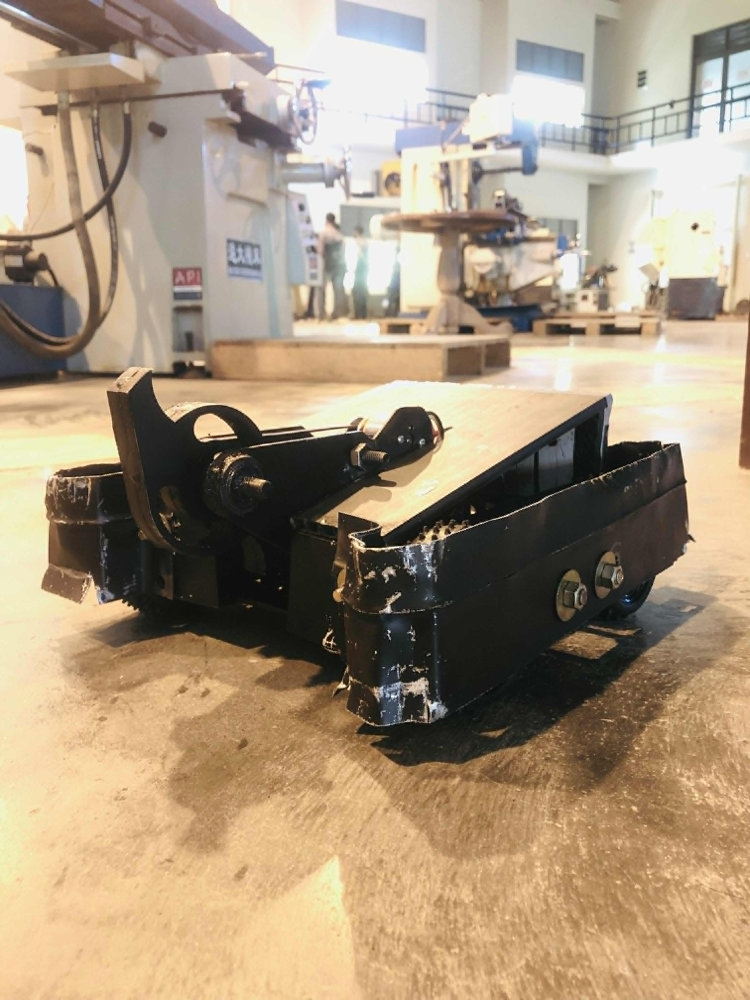

# Buffalo Shogun | Middleweight Battle Robot



Designed and developed a remote-controlled middleweight battle robot using **Onshape CAD/CAM**, integrating a **dual weapon system**, an **Arduino Nano-based control system**, and a **stainless-steel chassis**. The project enhanced skills in mechanical design, robotic systems, fabrication, and prototype development.

## Highlights

- **Chassis:** stainless-steel construction
- **Weapons:** dual weapon system
- **Control:** remote-controlled, Arduino Nano-based control system
- **Design:** fully modelled in Onshape (cloud CAD), with parts and assemblies including the blade, jumping disc and 12 V motor
- **Skills developed:** mechanical design, robotic systems, fabrication, prototype development

## CAD Model

The robot was designed in Onshape. Anyone with the link below can open the document, make their own copy, and modify it for their own build.

**[Open the Buffalo Shogun CAD model in Onshape](https://cad.onshape.com/documents/e72be95f44cf8685a0e4c5ee/w/4ed392625c60a90ff31f4a2b/e/4e754ebb3765c510ab770b11?renderMode=0&leftPanel=false&uiState=6ad6d49410631df79a423039)**

To make your own copy: open the link, sign in to Onshape (a free account works), then use **Document menu > Copy workspace**.


## More Images

More photos of the build are on LinkedIn: **[View on LinkedIn](https://lnkd.in/p/gd2fsMA5)**

## Repository Structure

```
Buffalo Shogun/
├── CAD File/
│   ├── Buffalo Shogun.txt   # Onshape document link
│   └── CAD image.PNG        # Screenshot of the Onshape assembly
├── img/
│   └── img1.jpeg            # Photo of the finished robot
└── README.md
```

## Author

**Thamindu Vishwajith Induruwage**
Mechanical Engineering undergraduate (BSc Engineering Honours), General Sir John Kotelawala Defence University (KDU), Sri Lanka
GitHub: [@FrankyThami](https://github.com/FrankyThami)
